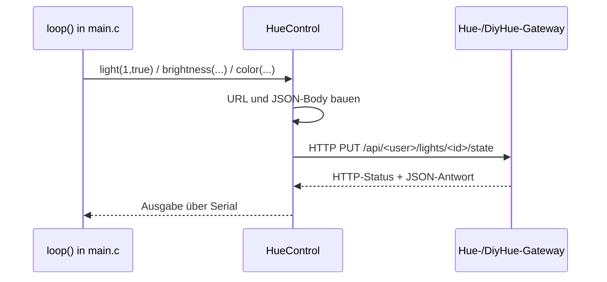
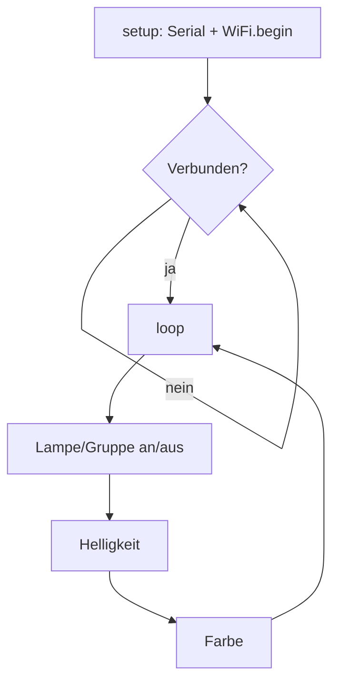

# Architektur

[← Zurück zur README](../README.md)

## Überblick

Das Projekt ist ein kleines ESP32-Firmware-Beispiel. Es besteht aus einer Demo-Anwendung (`main.c`) und einer Hilfsbibliothek (`HueControl.c/.h`), die Befehle als HTTP-`PUT`-Requests an die Hue-API eines Gateways (DiyHue) sendet.

## Komponenten

| Komponente | Datei | Aufgabe |
|---|---|---|
| Demo / Hauptprogramm | `main.c` | WLAN-Verbindung in `setup()`, Demo-Schleife in `loop()`; definiert `ip` und `user_name` |
| Hue-Bibliothek | `HueControl.c`, `HueControl.h` | Funktionen `light`, `group`, `brightness`, `color` |
| CI | `.github/workflows/msbuild.yml` | MSBuild-Workflow (nicht passend zum Projekt, Annahme) |

## Datenfluss

## Ablauf

## Request-Aufbau

- Lampen: `http://<ip>/api/<user_name>/lights/<id>/state`
- Gruppen: `http://<ip>/api/<user_name>/groups/<id>/action`
- Body: `{"on":true|false}`, `{"bri":N}` oder `{"xy":[x,y]}`
- Header `Content-Type: text/plain`
